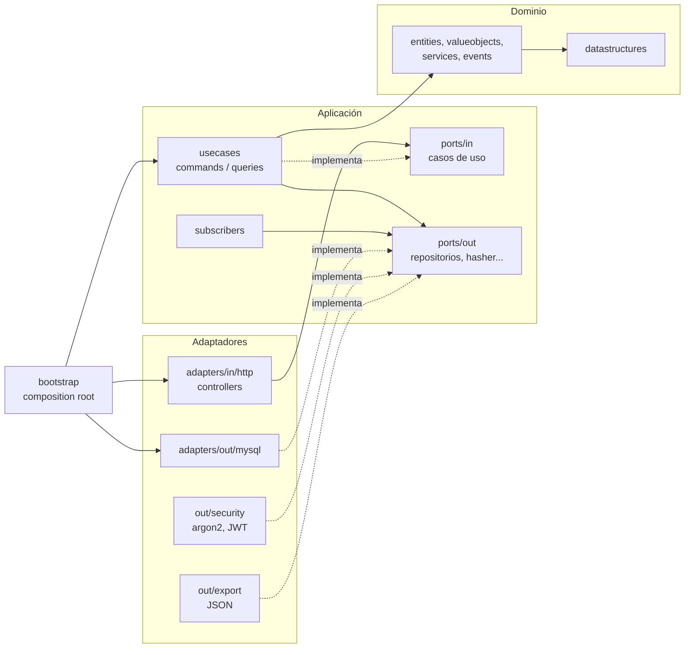

# Arquitectura

HubFlow es hexagonal **por contexto** (screaming architecture): cada contexto de negocio tiene su propio
`domain`, `application` y `adapters`, y la carpeta dice de qué trata el sistema, no qué framework usa.

```text
src/
  datastructures/            estructuras propias (hubflow::ds)
  hubflow/
    shared/                  núcleo compartido (errores, eventos, bus, idempotencia)
    <contexto>/              logistics | sorting | routing | identity | insights | audit
      domain/                entities, valueobjects, events, services
      application/           ports/in, ports/out, usecases/{commands,queries}, subscribers, hydration
      adapters/              in/http, out/mysql, out/export, out/security, out/system
    platform/                config, mysql, http (router, validación, problem+json)
  bootstrap/                 composition root y seeder
  main.cpp
```

## Dependencias



Reglas:

- `domain` solo conoce `datastructures` y `shared/domain`.
- `application` depende de `domain` y define los puertos (`ports/in` los consumen los controllers y los
  tests; `ports/out` los implementan los adaptadores).
- `adapters` implementan puertos y dependen de `application`. Solo en `datastructures/` y `domain/` se usan
  punteros crudos y se evita la STL; los adaptadores usan STL y `std::unique_ptr`.
- `bootstrap` es el único lugar que conoce todo y cablea puertos con adaptadores.

## Flujo de un caso de uso

Ejemplo: `POST /api/v1/shipments` (registrar un envío).

1. `ApiRouter` autentica el Bearer JWT, valida el rol y, si hay `Idempotency-Key`, busca una respuesta guardada.
2. `ShipmentController` valida el JSON con `InputValidator` y llama al puerto de entrada
   `RegisterShipmentUseCase`.
3. El caso de uso (`RegisterShipment`) arma el agregado `Shipment` (que valida invariantes y levanta el
   evento `ShipmentReceived`), lo entrega al modelo en memoria y publica los eventos del agregado en el bus.
4. El `EventBus` entrega cada evento, de forma síncrona, a los suscriptores en este orden:
   1. `PendingShipmentsProjector`: proyecta el modelo en memoria (lista de pendientes).
   2. `ShipmentPersistenceSubscriber`: guarda envío y movimiento en MySQL.
   3. `RoutePersistenceSubscriber`: persiste rutas (no reacciona a este evento).
   4. `UserPersistenceSubscriber`: persiste usuarios (no reacciona a este evento).
   5. `CatalogPersistenceSubscriber` y `RoadMapPersistenceSubscriber`: persisten zonas, servicios,
      características y puntos del mapa (no reaccionan a este evento).
   6. `RoutePlanExportSubscriber`: exporta `initial_state.json` y `sequence.json` al asignar una ruta.
   7. `AuditLogSubscriber`: registra el evento en la bitácora.
5. El controller arma la respuesta (201 + `Location`), `ApiRouter` la guarda bajo la clave de idempotencia.

El orden es deliberado: primero las proyecciones del modelo, luego la persistencia y al final la auditoría
y los efectos externos. La exportación a archivos está envuelta en un decorador que registra el fallo pero
no deshace la operación.

## Datos maestros y políticas (extensibilidad)

Agregar una zona, un servicio, una característica de envío o un punto del mapa es una operación de datos
(API o pantalla "Configuración"), sin tocar el programa. Quitar algo es desactivarlo, nunca borrarlo, y las
reglas del dominio evitan dejar estados huérfanos.

| Dato | Dónde vive | Regla de baja |
|---|---|---|
| Zona `{code, name, active}` | `logistics/domain/entities/zone`, catálogo `ReferenceCatalog<Zone>`, tabla `zones` | sin paquetes en planta de esa zona, sin rutas en curso que pasen por ella y sin puntos activos del mapa asignados (se pasan a otra zona con `PATCH /road-nodes/:id`) |
| Servicio `{code, name, priority, active}` | `logistics/domain/entities/serviceLevel`, tabla `service_levels` | sin paquetes en planta con ese servicio; la prioridad se fija al crearlo |
| Característica `{code, name, active}` | `logistics/domain/entities/shipmentFeature`, tablas `shipment_features` y `shipment_feature_links` | sin restricción: solo deja de poder etiquetar envíos nuevos |
| Punto del mapa con `zone` y `active` | `routing/domain/entities/roadMap` (`declareNode`, `reviseNode`), tabla `road_nodes` | el centro de distribución no se desactiva; un punto inactivo deja de aceptar paquetes pero la calle sigue |
| Permisos por rol | `identity/domain/services/accessPolicy`, tabla `role_permissions`, cargados al iniciar (`AccessPolicyHydrator`) | los roles siguen siendo ADMIN/OPERADOR/PUM |

- **Prioridad de despacho.** `PendingShipments` pregunta a un `PriorityPolicy` (Strategy) cuánto prioriza cada
  envío; la implementación por defecto, `CatalogPriorityPolicy`, usa la prioridad del servicio en el catálogo y
  desempata por el ticket de llegada (lista estable). Un servicio nuevo con mayor prioridad sale primero sin
  tocar la lista.
- **Puertos del dominio entre contextos.** `PlantOccupancy` (qué impide dar de baja una zona o un servicio) lo
  implementa `RoutingPlantOccupancy`; `CourierWorkload` (el chofer tiene un reparto en curso) lo implementa
  `RoutingCourierWorkload`; `ZoneDirectory` (la zona existe y está activa) lo implementa `LogisticsZoneDirectory`.
- **Chofer con reparto en curso.** No se puede desactivar ni cambiar de puesto (`user.has_route_in_progress`)
  hasta que `ReassignDeliveryRoute` (`PUT /routes/:id/courier`, jefe de planta o administrador) pase la ruta a
  otro chofer activo. El cambio levanta `DeliveryRouteReassigned`, se audita y se persiste.
- **Mapa.** Los puntos nuevos se agregan con `POST /road-nodes` (zona, coordenadas y calles hacia puntos
  existentes, con costo mayor o igual a la línea recta para que A* siga siendo admisible) y se reasignan o
  desactivan con `PATCH /road-nodes/:id`. La pantalla "Configuración" calcula las coordenadas a partir de
  "queda a X km hacia el Norte/Sur/Este/Oeste de tal lugar".
- `Vocabulary` ya no traduce zonas ni servicios: sigue solo para enumerados cerrados (estados, roles,
  permisos, resultados, algoritmos).

Migración `db/migrations/004_catalogs.sql`: crea las tablas, siembra CENTRO/NORTE/SUR, EXPRESS/PRIORITARIO/
ESTANDAR, las características y los permisos, y reemplaza los `ENUM` de zona y servicio por referencias.
Docker solo corre las migraciones sobre un volumen nuevo: para aplicarla sobre una base existente usar
`make reset-db` (borra los datos del proyecto) y luego `make up`.

## Envío, bultos, grupos y códigos de seguimiento

- **Identidad y código.** Un `Shipment` se identifica internamente por un `ShipmentId` (UUID versión 7, generado por
  el puerto `IdentityGenerator`; adaptador `UuidV7IdentityGenerator`, RFC 9562: 48 bits de milisegundos, contador
  de 12 bits que mantiene el orden dentro del mismo milisegundo, variante y 62 bits al azar). Hacia afuera se lo
  reconoce por su `TrackingCode`, que asigna el puerto `TrackingCodeGenerator`: `PublicTrackingCodeGenerator`
  (`HF-` + 8 símbolos Crockford + 1 verificador, módulo 37 con peso por posición; no es secuencial y se reintenta
  ante colisión) o `SequentialPkgCodeGenerator` (`PKG-NNNN`, el del dataset del TP). Se elige con
  `HUBFLOW_TRACKING_CODES=public|sequential` (por defecto `public`); los datos de ejemplo siempre llevan
  `PKG-1001..1008`. El operador no informa el código: lo devuelve el alta. `TrackingCode` acepta ambos formatos,
  valida el verificador del público y, al tener largo fijo dentro de cada formato, sigue sirviendo de clave del
  BST, del B+ y de la búsqueda binaria (el orden es lexicográfico; el del formato público no coincide con el de
  alta).
- **Bultos.** Un envío tiene de 1 a 20 `Parcel` con etiqueta `<código>-<n>/<total>`, peso y `Dimensions`
  (largo, ancho y alto en cm, de 0 a 300). Peso volumétrico = largo·ancho·alto / 5000; peso facturable =
  mayor entre el real y el volumétrico; el peso del envío (`weightKg()`, el que usan las ordenaciones, los
  resúmenes y las métricas) es la suma de los facturables. Los bultos están en una `ds::DynamicArray<Parcel*>`.
- **Entrega con bultos.** El envío sólo pasa a ENTREGADO con todos sus bultos confirmados
  (`Shipment::confirmParcel`, evento `ParcelDeliveryConfirmed`). El chofer puede confirmar bulto por bulto
  (`ConfirmStopParcel`), "entregar todo" (`confirmAllParcels`) o terminar con lo entregado: la parada se
  informa como no entregada, el envío vuelve a REPROGRAMADO con los bultos entregados registrados y al
  volver a salir sólo faltan los restantes.
- **Envíos que viajan juntos.** `ShipmentGroup` es un agregado de 2 a 20 envíos del mismo punto de entrega,
  todos esperando despacho y sin otro grupo (`ShipmentGroupBook` verifica las reglas). La mesa de
  clasificación no carga uno sin los demás: cargar "el siguiente" trae al grupo entero y cargar por código sin
  los compañeros responde 409 (`sorting.group_incomplete`); al asignar la ruta el grupo es una única parada
  (`RouteStop::companions`); reprogramar uno (o dar por no entregada la parada) reprograma a todos; despachar
  el primero de la lista despacha a todo el grupo. Un grupo con un envío en reparto no se deshace.
- **Persistencia.** Migración `005_shipments_parcels_groups.sql`: `shipments.id CHAR(36)` + `tracking_code`,
  `parcels`, `shipment_groups`, `shipment_group_members` y `route_stop_companions`. Los movimientos, las paradas
  y las características siguen referenciando al envío por su código de seguimiento. La hidratación restaura
  bultos y grupos. Eventos nuevos: `ParcelDeliveryConfirmed`, `ShipmentGroupFormed`, `ShipmentGroupDissolved`
  (persistencia y auditoría).
- **Seguimiento del cliente (siguiente etapa).** El código público ya es el que se imprime en la etiqueta y no
  se puede adivinar; el estado público de un envío y la verificación del destinatario se agregan encima de esta
  base sin tocar el modelo.

## Arranque

`Application` lee las variables de entorno (`Settings`), espera a MySQL, aplica la hidratación
(`AccessPolicyHydrator`, `LogisticsHydrator` y `RoutingHydrator` cargan permisos, datos maestros y reconstruyen el modelo en memoria desde la base), siembra los datos
iniciales si están vacíos y recién entonces suscribe el bus y abre el puerto. Las consultas se atienden
desde el modelo en memoria; MySQL es el almacén durable. El router serializa los pedidos con un mutex, por
lo que el modelo no necesita sincronización interna.
