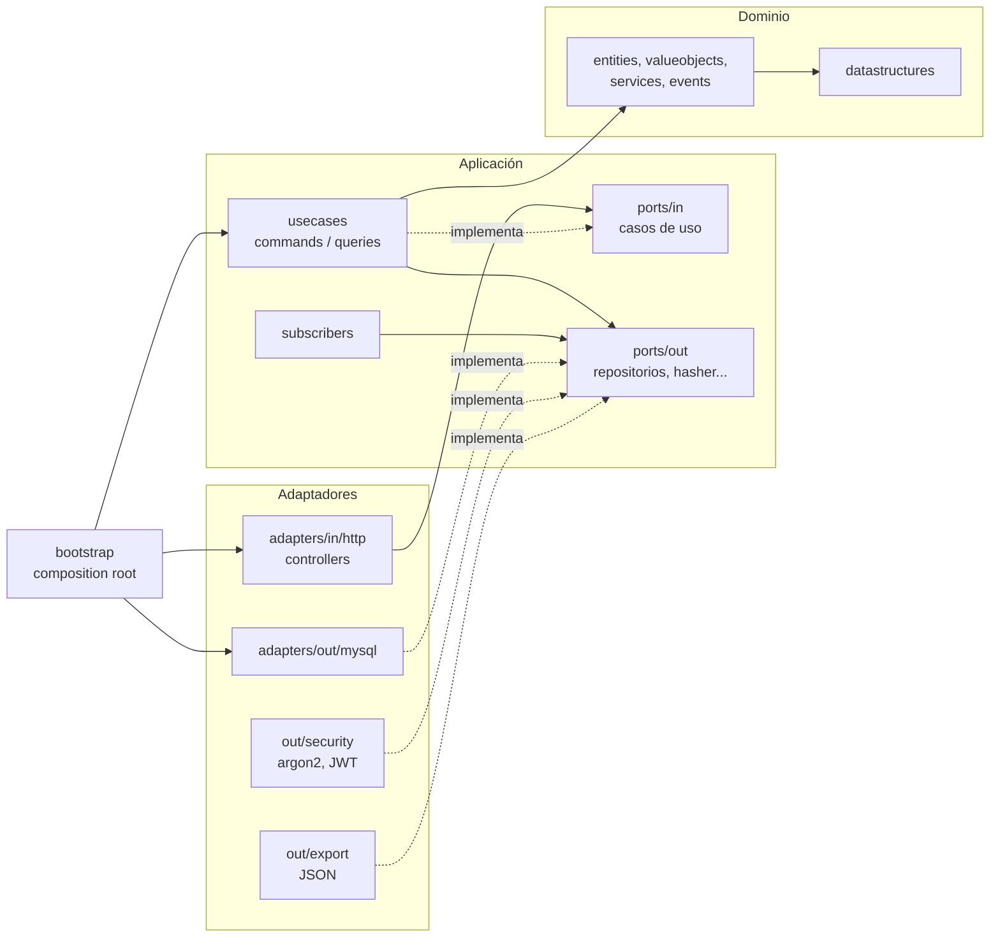

# Arquitectura

HubFlow es hexagonal **por contexto** (screaming architecture): cada contexto de negocio tiene su propio
`domain`, `application` y `adapters`, y la carpeta dice de qué trata el sistema, no qué framework usa.

```text
src/
  datastructures/            estructuras propias (hubflow::ds)
  hubflow/
    shared/                  núcleo compartido (errores, eventos, bus, idempotencia)
    <contexto>/              logistics | sorting | routing | identity | insights | audit
      domain/                entities, valueobjects, events, services
      application/           ports/in, ports/out, usecases/{commands,queries}, subscribers, hydration
      adapters/              in/http, out/mysql, out/export, out/security, out/system
    platform/                config, mysql, http (router, validación, problem+json)
  bootstrap/                 composition root y seeder
  main.cpp
```

## Dependencias



Reglas:

- `domain` solo conoce `datastructures` y `shared/domain`.
- `application` depende de `domain` y define los puertos (`ports/in` los consumen los controllers y los
  tests; `ports/out` los implementan los adaptadores).
- `adapters` implementan puertos y dependen de `application`. Solo en `datastructures/` y `domain/` se usan
  punteros crudos y se evita la STL; los adaptadores usan STL y `std::unique_ptr`.
- `bootstrap` es el único lugar que conoce todo y cablea puertos con adaptadores.

## Flujo de un caso de uso

Ejemplo: `POST /api/v1/shipments` (registrar un envío).

1. `ApiRouter` autentica el Bearer JWT, valida el rol y, si hay `Idempotency-Key`, busca una respuesta guardada.
2. `ShipmentController` valida el JSON con `InputValidator` y llama al puerto de entrada
   `RegisterShipmentUseCase`.
3. El caso de uso (`RegisterShipment`) arma el agregado `Shipment` (que valida invariantes y levanta el
   evento `ShipmentReceived`), lo entrega al modelo en memoria y publica los eventos del agregado en el bus.
4. El `EventBus` entrega cada evento, de forma síncrona, a los suscriptores en este orden:
   1. `PendingShipmentsProjector`: proyecta el modelo en memoria (lista de pendientes).
   2. `ShipmentPersistenceSubscriber`: guarda envío y movimiento en MySQL.
   3. `RoutePersistenceSubscriber`: persiste rutas (no reacciona a este evento).
   4. `UserPersistenceSubscriber`: persiste usuarios (no reacciona a este evento).
   5. `RoutePlanExportSubscriber`: exporta `initial_state.json` y `sequence.json` al asignar una ruta.
   6. `AuditLogSubscriber`: registra el evento en la bitácora.
5. El controller arma la respuesta (201 + `Location`), `ApiRouter` la guarda bajo la clave de idempotencia.

El orden es deliberado: primero las proyecciones del modelo, luego la persistencia y al final la auditoría
y los efectos externos. La exportación a archivos está envuelta en un decorador que registra el fallo pero
no deshace la operación.

## Arranque

`Application` lee las variables de entorno (`Settings`), espera a MySQL, aplica la hidratación
(`LogisticsHydrator`, `RoutingHydrator` reconstruyen el modelo en memoria desde la base), siembra los datos
iniciales si están vacíos y recién entonces suscribe el bus y abre el puerto. Las consultas se atienden
desde el modelo en memoria; MySQL es el almacén durable. El router serializa los pedidos con un mutex, por
lo que el modelo no necesita sincronización interna.
